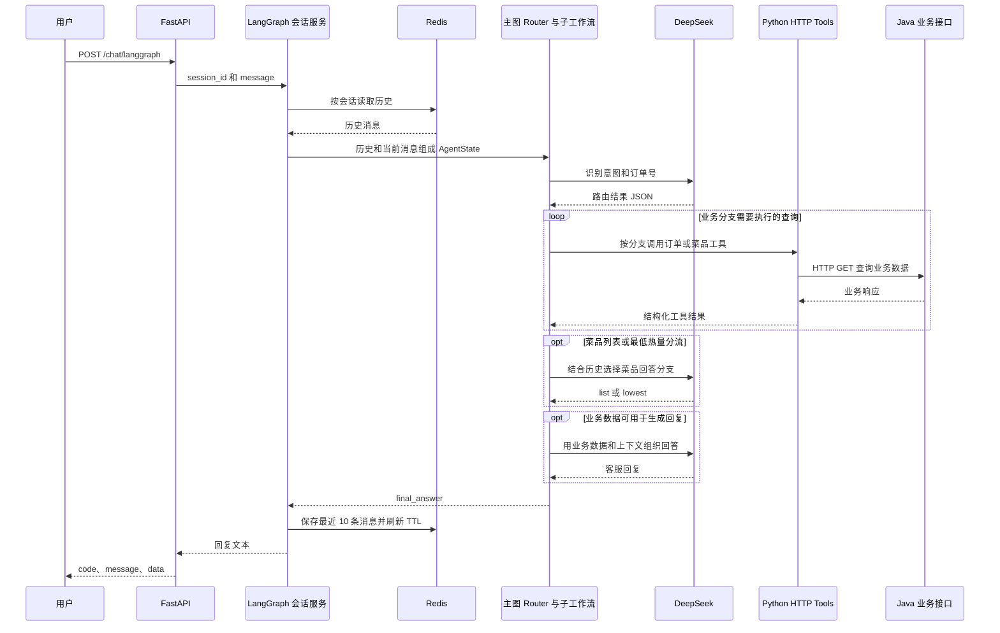
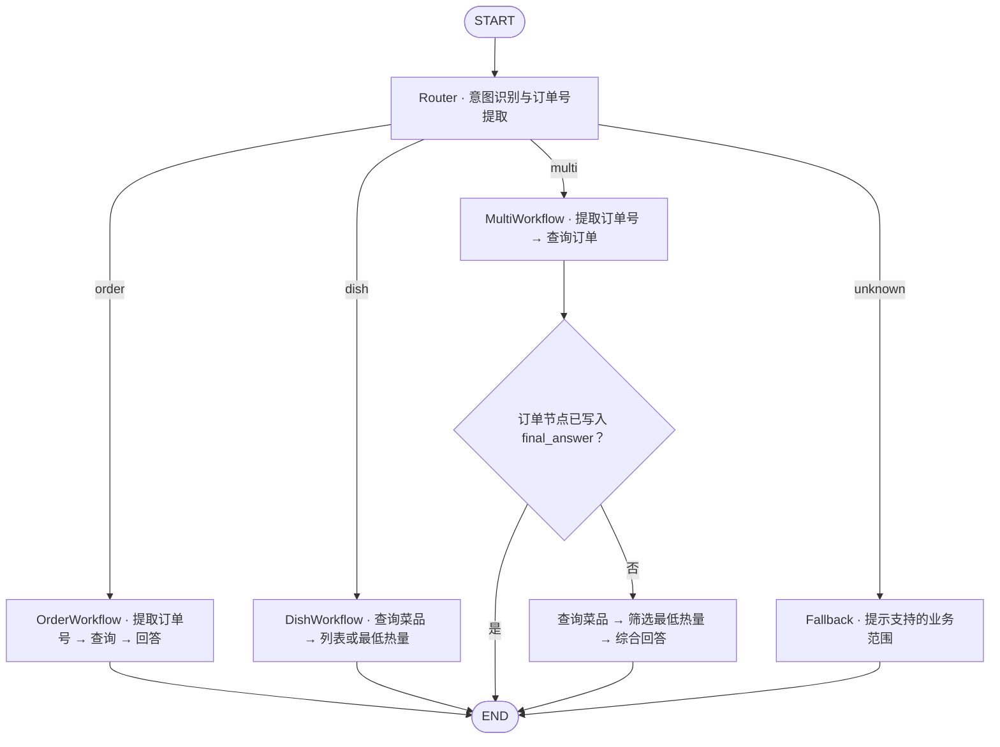

# 基于 LangGraph 的餐饮智能客服 Agent

面向餐饮外卖场景，用户可以用自然语言查询订单状态、查看低脂菜品，或在同一条消息里同时提出两个需求。客服可以结合当前会话继续处理「现在到哪了」「哪个热量最低」等追问。Python 服务负责对话与工作流编排，订单和菜品数据由 Java 业务接口提供。

**核心技术栈** · Python 3.12 · FastAPI / Uvicorn · LangGraph · LangChain / ChatOpenAI · DeepSeek · Redis · Tool Calling · Requests / HTTP JSON API

## 核心功能

| 功能 | 实现 |
| --- | --- |
| 意图识别与分流 | [Router](ai_service/agent/langgraph_core/nodes/router_node.py) 将近期对话和本轮消息交给 DeepSeek，解析 `intent`、`order_id` 和 `need_dish_recommendation`，由主图选择订单、菜品、复合请求或兜底分支。 |
| 业务工具 | [订单工具](ai_service/tools/order_tool.py) 和 [菜品工具](ai_service/tools/dish_tool.py) 用 HTTP GET 获取结构化业务数据。LangGraph 由节点决定何时执行工具，`/chat` 使用同一组工具的 OpenAI 兼容 Tool Calling 定义。 |
| 多轮记忆与追问 | [会话服务](ai_service/agent/langgraph_core/service.py) 按 `session_id` 加载历史。本轮结束后保留最近 10 条用户及助手消息，通过 [SessionMemory](ai_service/agent/session_memory.py) 写入 Redis 并刷新 30 分钟 TTL。订单号缺失时，订单节点可从当前输入或历史中提取。 |
| 一次处理两个需求 | [MultiWorkflow](ai_service/agent/langgraph_core/workflows/multi_workflow.py) 按顺序查订单、查低脂菜、筛选最低热量菜品，并生成一条综合回复。 |

## 系统架构



## LangGraph 工作流设计



- **OrderWorkflow** 优先使用 Router 提取的订单号，其次检查当前输入和最近会话消息。缺少订单号时提示补充，查询失败时返回重试提示。成功时根据订单数据生成回复，回答模型失败时回落到固定格式。
- **DishWorkflow** 先拉取菜品列表，再由模型结合会话选择 `list` 或 `lowest`，后者按 `calories` 取最小值。菜品工具即使失败，仍会经过子路由，随后由回答节点保留已设置的失败提示。
- **MultiWorkflow** 发现订单缺参或工具查询失败时，沿 END 分支返回已有提示。菜品查询失败时仍保留订单结果，由综合回答节点说明当前没有合适的菜品推荐。
- **Fallback** 接收 `unknown` 意图并提示业务范围。Router 返回的 JSON 无法解析时也进入此分支。Router 模型请求抛错时由 FastAPI 的异常处理返回 `code=0`。

[AgentState](ai_service/agent/langgraph_core/state.py) 携带 `session_id`、原始输入 `user_input` 和上下文 `messages`，由 Router 写入意图与订单号。后续节点填充 `order_info`、`dishes`、`best_dish` 和 `final_answer`。`need_dish_recommendation` 记录模型判断，主图依据 `intent` 决定分支。

LangGraph 将工具调用顺序、缺参处理和提前结束条件写入代码。模型承担语义识别和表达组织，图控制业务步骤，工具输出可独立检查。Redis 将上下文保存在请求进程之外，供下一次使用同一会话 ID 的请求加载。

## 典型对话

以下均为说明流程的示意输入。订单号为占位示例，实际验证需要换成测试库中的订单号。

| 场景 | 示例输入 | 工作流行为 |
| --- | --- | --- |
| A. 查询订单 | 「帮我查一下订单 123456789012 的状态」 | 用订单号查询 Java 接口并组织状态回复。 |
| B. 菜品追问 | 「有哪些低脂菜？」→「哪个热量最低？」 | 同一会话下先列出菜品，再在新查询返回的菜品中比较热量。 |
| C. 复合请求 | 「查一下订单 123456789012，再推荐一道低脂菜」 | 先查订单，随后查菜品并给出综合回复。 |
| D. 订单追问 | 「查一下订单 123456789012」→「现在到哪了？」 | 同一会话下从上下文补全订单号并重新查询订单。 |

## 项目目录与入口

```text
ai_service/
├── main.py                 # FastAPI 应用与三个 HTTP 路由
├── main_langchain.py       # 独立 LangChain 命令行实验
├── config.py               # 模型、服务、工具超时与 Redis 配置
├── requirements.txt       # Python 依赖
├── models/request.py       # ChatRequest 和 ApiResponse
├── agent/
│   ├── core.py             # OpenAI SDK 多轮 Tool Calling Agent
│   ├── langchain_core.py   # create_agent 与进程内会话记忆实验
│   ├── session_memory.py   # Redis 会话读写与清除
│   ├── langgraph_core/     # 主图、会话服务、状态、节点和子工作流
│   └── langgraph_demo/     # 早期路由与工作流实验
└── tools/                  # Java 订单及菜品接口的 HTTP 封装
```

| HTTP 入口 | 参数与用途 |
| --- | --- |
| `POST /chat/langgraph` | JSON `session_id`、`message`，运行本文展示的 LangGraph 主流程。 |
| `POST /chat` | 同一请求体，运行 [AgentCore](ai_service/agent/core.py) 的模型驱动 Tool Calling 循环。 |
| `POST /session/clear?session_id=...` | 查询参数 `session_id`，尝试清空两个聊天入口各自前缀下的 Redis 会话键。 |

独立 [LangChain CLI](ai_service/main_langchain.py) 使用 `create_agent` 和 `InMemorySaver`。`langgraph_demo/` 收录早期实验，主 API 使用 `langgraph_core/graph.py` 与 `nodes/router_node.py`。CLI 和早期订单演示仍引用已移除的 `get_order_status`，当前存在导入错误。

## 快速开始

### 1. 安装 Python 依赖

推荐使用 Python 3.12。源码使用 Python 3.10 引入的类型语法，当前依赖清单未锁版。以下命令以 Windows PowerShell 为例，从仓库根目录执行。

```powershell
python --version
python -m venv .venv
.\.venv\Scripts\python.exe -m pip install -r ai_service/requirements.txt
```

### 2. 准备 Redis、模型与 Java 接口

- **Redis** 默认连接 `127.0.0.1:6379` 的 DB `3`，密码为空。已有本地 Redis 时可直接使用，或在安装 Docker 后执行 `docker run --rm --name ai-service-redis -p 127.0.0.1:6379:6379 redis:7-alpine`。其他 Redis 设置需在 [config.py](ai_service/config.py) 中调整，演示时可使用仅监听本机的单独实例。
- **DeepSeek** 在启动进程的环境中设置 `DEEPSEEK_API_KEY`。配置使用 `deepseek-chat` 和 `https://api.deepseek.com`。[.env.example](.env.example) 记录变量名，项目当前直接读取进程环境。将模板复制成 `.env` 后，仍需自行把变量导入进程。Redis 地址、密码、服务端口和工具超时等在源码中配置。
- **Java 后端** 需在 `localhost:8080` 运行包含下列接口的业务服务，并连接含脱敏测试订单和菜品的数据库。本仓库只包含 Python 服务。两条接口已在本地配套 `sky_take_out` 的 `sky-server` 模块中核对，相关 Controller 位于其未提交改动中，启动配套服务前需确认检出的版本含这些接口。

| Java 接口 | Python 工具读取的数据 |
| --- | --- |
| `GET /ai/order/info/{orderNumber}` | 用业务订单号查询，读取 `code=1` 的 `data`，可包含订单状态、支付状态与明细。 |
| `GET /dish/low-fat` | 读取 `data` 菜品列表，使用 `name` 和 `calories` 生成回答。 |

两个工具均使用 `Config.TOOL_TIMEOUT`，默认 5 秒。HTTP 地址由工具源码指定。目前接口缺少订单归属和会话所有权校验，请在本地使用脱敏数据演示。

### 3. 启动 API 并发送请求

在启动服务的 PowerShell 窗口中设置环境变量。用自己的 Key 替换示例值。进入 `ai_service/` 后启动，使 `agent`、`tools` 和 `config` 的导入路径与代码一致。

```powershell
$env:DEEPSEEK_API_KEY = '替换为你的 DeepSeek API Key'
Set-Location ai_service
..\.venv\Scripts\python.exe -m uvicorn main:app --host 127.0.0.1 --port 8000
```

启动后可打开 [Swagger UI](http://127.0.0.1:8000/docs) 或 [OpenAPI JSON](http://127.0.0.1:8000/openapi.json)。在另一个 PowerShell 窗口发送两次请求，复用 `$sessionId` 验证追问。

```powershell
$api = 'http://127.0.0.1:8000'
$sessionId = [guid]::NewGuid().ToString()

foreach ($message in @('有哪些低脂菜？', '哪个热量最低？')) {
    $body = @{ session_id = $sessionId; message = $message } | ConvertTo-Json
    Invoke-RestMethod -Method Post -Uri "$api/chat/langgraph" `
        -ContentType 'application/json; charset=utf-8' -Body $body
}

Invoke-RestMethod -Method Post -Uri "$api/session/clear?session_id=$sessionId"
```

聊天响应使用 `code`、`message`、`data` 三个字段。`code=1` 表示接口返回了客服文本，具体业务结果或失败提示在 `data` 中。接口捕获异常后返回 `code=0`，无效请求体由 FastAPI 返回 HTTP 422。

## 验证范围

仓库中两个以 `test_` 开头的文件是手动演示，尚无可直接运行的自动化用例。[主图演示脚本](ai_service/agent/langgraph_core/test_langgraph_core.py) 仍只传入一条消息，当前 `chat_with_langgraph` 需要同时传入 `session_id` 和 `user_input`。[早期订单演示](ai_service/agent/langgraph_demo/test_order_graph.py) 依赖的订单工具导入已失效。建议用上面的 HTTP 入口验证当前主流程。

| 手动验证 | 操作与观察点 |
| --- | --- |
| 订单成功与缺参 | 用测试订单号查询，再换新会话发送无订单号的问题，检查是否补问订单号。 |
| 两类连续追问 | 分别用相同会话 ID 追问订单进度和最低热量，再换会话 ID 比较上下文。 |
| 复合请求 | 使用可查询的订单号，检查回复是否先呈现订单结果，再推荐菜品。 |
| 无效订单与接口异常 | 使用不存在的测试订单号，或暂停本地 Java 服务，检查失败提示。在复合请求中，订单失败应提前结束。 |
| 会话清空 | 调用 `/session/clear` 后用原会话 ID 再追问。Redis 可用时，上下文应被清除。 |

真实端到端验证需要可用的 Redis、Java 接口及测试数据、有效的 DeepSeek Key 和模型额度。FastAPI 文档能打开只代表应用成功加载。

## 技术演进

- [`dfbc8a2`](https://github.com/xucd666/AI-Service/commit/dfbc8a2) 建立 FastAPI、OpenAI 兼容 Tool Calling、Redis 和 Java 工具接口，随后加入独立 LangChain 实验。
- [`bb89c37`](https://github.com/xucd666/AI-Service/commit/bb89c37) 将 LangGraph 工作流接入 FastAPI。后续迭代加入模型路由、答案生成和复合任务分支。
- [`7b950f0`](https://github.com/xucd666/AI-Service/commit/7b950f0) 为 LangGraph 接入独立会话前缀与 Redis 上下文，[`4809fee`](https://github.com/xucd666/AI-Service/commit/4809fee) 完善订单与菜品的连续追问及复合任务。

当前项目适合使用测试数据演示工作流。进一步展示可以补齐可重复的集成测试、发布配套 Java 接口版本，并在接入真实用户前实现访问控制和日志脱敏。
